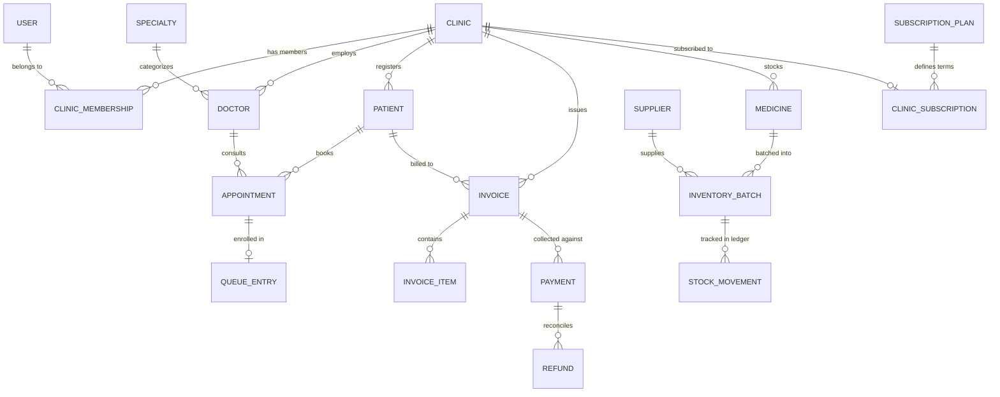

# Database Relationships & Data Architecture

## Overview
The ClinicFlow data layer is designed for PostgreSQL / Supabase with strict tenant isolation, foreign keys, unique constraints, and decimal monetary representation (INR).

---

## Entity Relationship Overview

---

## Tenant Isolation Rules
1. **Direct Tenant Foreign Keys:**
   Every clinic-owned entity (`doctors`, `patients`, `appointments`, `invoices`, `payments`, `medicines`, `inventory_batches`, `stock_movements`, `queue_entries`) has an explicit, indexed `clinicId` foreign key referencing `clinics(id)` with `ON DELETE CASCADE`.
2. **Composite Unique Keys:**
   - `invoices`: `UNIQUE (clinicId, invoiceNumber)` prevents invoice number collision across clinics while guaranteeing sequential numbering per clinic.
   - `inventory_batches`: `UNIQUE (clinicId, medicineId, batchNumber)` guarantees batch uniqueness within tenant.
   - `queue_entries`: `UNIQUE (clinicId, date, tokenNumber)` ensures sequential token numbers reset cleanly per clinic per day.
   - `clinic_memberships`: `UNIQUE (clinicId, userId)` ensures each user has an unambiguous role per clinic.
3. **Decimal Monetary Safety:**
   All financial fields (`consultationFee`, `totalAmount`, `paidAmount`, `outstandingAmount`, `purchaseCost`, `sellingPrice`) use SQL `DECIMAL(10, 2)` to eliminate floating-point rounding inaccuracies.
